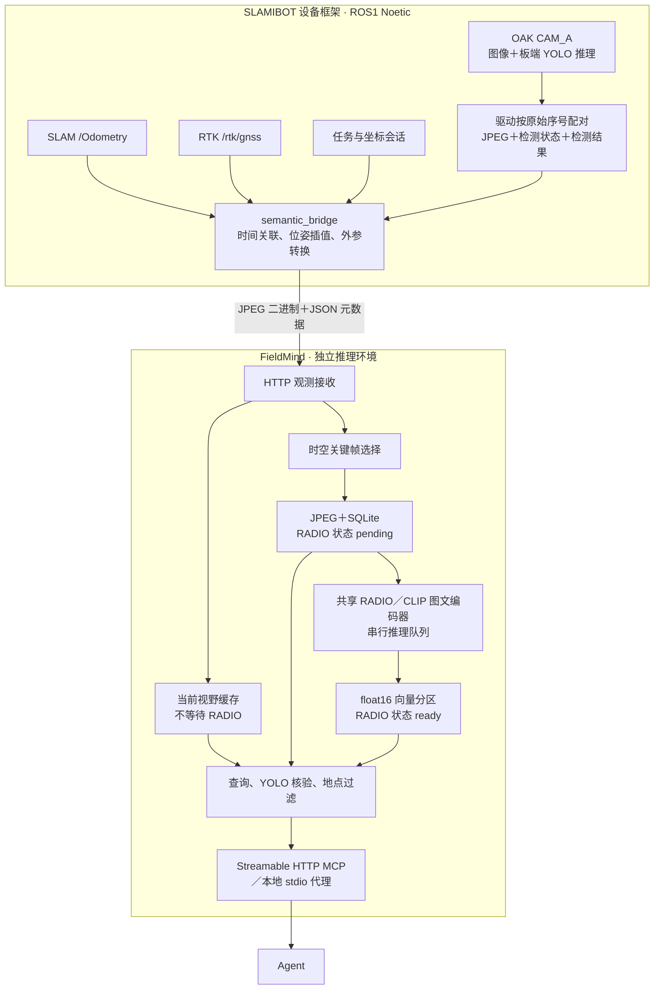

# SLAMIBOT FieldMind

**让机器人记住现场，也让现场可以被询问。**

FieldMind 是 SLAMIBOT 的移动机器人视觉记忆后端，面向小车、机器狗的工厂／园区巡检。它接收图像、YOLO 检测、位姿及任务状态，保存时空关键帧，用 RADIO 建立语义索引，通过 HTTP 与 MCP 向 Agent 提供当前视野、历史检索和图片证据。

Python 包名为 `slamibot_fieldmind`。本项目完整承接原视觉后端，使用独立仓库和统一的新命名；数据协议、向量空间和历史库格式沿用原实现。迁移说明见 [仓库与命名迁移](docs/repository_migration.md)。

## 与设备框架的关系

FieldMind 是独立后端；设备驱动、SLAM、导航和 ROS 桥接保留在 [SLAMIBOT_D360_Framework](https://github.com/electech6/SLAMIBOT_D360_Framework)。框架接入分支为 `feat/semantic-perception-integration`，接入 PR 为 [#11](https://github.com/electech6/SLAMIBOT_D360_Framework/pull/11)。



设备部署时，YOLO 神经网络在 OAK RVC2 上运行，驱动侧完成解码、NMS 和帧关联；RADIO 在 Orin NX 上异步运行。ROS 环境保留 DepthAI 2.30，后端环境不需要 DepthAI，也不直接打开 OAK。

JetPack 5 上 RADIO 走 GPU 编码侧车：Python 3.8 进程持有 CUDA 11.4 torch 与模型，Python 3.11 后端经 loopback HTTP 取向量（`--encoder-url`），见 [docs/orin_nx_gpu_encoder.md](docs/orin_nx_gpu_encoder.md)。无 CUDA torch 时自动回退 CPU，健康检查会报告实际设备。

现有离线演示采用 Ubuntu 虚拟机回放 `walk02.bag`、Windows OpenVINO CPU 执行 YOLO、Windows GPU 执行 RADIO。该回放方案与设备部署方案共用观测协议及查询服务。

## 已有能力

- 当前视野：从持续观测缓存返回 YOLO 类别、数量、检测状态、拍摄时间和过期状态。
- 历史检索：RADIO 召回后，对 YOLO 支持的类别做同帧核验；其他对象返回语义候选，保留相似度与证据限制。
- 时空记忆：按平移、三维旋转或超时选择关键帧；任务、SLAM 会话、坐标会话和相机分别记录。
- 证据读取：关键帧 JPEG、位姿、检测框、同步质量、推理状态与模型指纹可查询。
- 地点查询：按指定坐标会话登记地点；返回在该地点附近拍到的历史观测。
- 故障恢复：持久化 pending 任务、重启恢复、接收幂等、队列限流、低磁盘空间暂停历史写入。

首版返回的是**在哪里拍到目标**。相机位姿不代表目标三维位置；RADIO 相似度不是概率，YOLO 未检出也不代表目标不存在。

## 安装与启动

以下命令从仓库根目录运行，使用可编辑安装。Python 需要 3.10 或更高版本。先为目标平台安装匹配的 PyTorch／CUDA，再安装本项目；Jetson 依赖必须根据实际 JetPack／L4T 选择，不能直接套用 Windows 锁定文件。`requirements.lock.txt` 仅记录原 Windows 验证环境。

JetPack 5 没有 Python ≥3.10 的 CUDA torch，此时后端用 CPU torch 运行，GPU 编码放在独立的 3.8 侧车进程里（`scripts/setup_gpu_encoder_env.sh` + `scripts/start_encoder_sidecar.sh`，后端加 `--encoder-url http://127.0.0.1:8791`）。

```bash
python -m pip install -e ".[backend,dev]"
```

准备固定版本的官方 RADIO 源码和模型，模型权重不随代码仓库发布：

```bash
git clone https://github.com/NVlabs/RADIO.git third_party/RADIO
git -C third_party/RADIO checkout 4ffaf15d0ff48197c194e306772bdb5fb92db230
python scripts/fetch_assets.py --asset radio_v2.5_b --asset dfn5b_clip_vit_h14_378
python scripts/fetch_assets.py --asset radio_v2.5_b --asset dfn5b_clip_vit_h14_378 --check
```

模型来源、摘要与许可信息见 [models/assets.json](models/assets.json)。板端 YOLO 模型归档需从已有模型包复制到清单指定位置，再用 `scripts/prepare_oak_model.py` 提取；后端接收设备检测结果时无需安装 `[oak]`。该可选依赖用于原独立相机模式，不能装进 DepthAI 2.30 的 ROS 环境。

本地开发启动：

```bash
slamibot-fieldmind --root data/backend --allow-unmounted --model-config configs/default.yaml
```

等价模块命令是 `python -m slamibot_fieldmind.backend`。默认监听 `127.0.0.1:8765`；健康检查为 `/v1/health`，MCP 为 `/mcp`。设备部署默认数据目录是 `/mnt/usb/slamibot_record_data/semantic_index`，不传 `--allow-unmounted`，并使用 `configs/jetson.yaml`。数据目录必须位于挂载卷内；若用 NVMe 或容器 `/data`，用 `--mount-path` 指定那一层挂载点，而不是长期依赖 `--allow-unmounted`。默认可用空间下限为 2 GiB。

Agent 可以直接连接 `http://127.0.0.1:8765/mcp`。需要 stdio 时，使用连接同一后端的轻量代理：

```bash
slamibot-fieldmind-mcp --url http://127.0.0.1:8765/mcp
```

代理不加载第二份模型。设备模式使用后端和代理；`mcp_server` 是独立相机模式，包含直接访问相机的路径。入口统一使用 `slamibot_fieldmind`，不提供旧包名兼容层。

## 关键帧与持久化

相对最近一张已持久化接受的关键帧，满足最小间隔 0.5 秒后，平移 ≥ 0.5 米或三维旋转 ≥ 15° 可立即触发；间隔 ≥ 3 秒时，还须累计平移 ≥ 0.05 米或旋转 ≥ 2°，才补一帧。静止和小幅位姿抖动不会因超时重复存帧。优先比较相机位姿，不可用时比较两帧的机身位姿，仅用于采样，不补造相机位姿。两类位姿均无法比较时保留时间采样，并明确标记无法判断运动；不同坐标会话之间不计算距离。

新关键帧编号和图片名采用 `kf-<32位唯一标识>-<UTC时间戳>`，例如 `kf-93b922c324faa6b2d04cf1e95ba96a35-20261025T010807123Z`。时间使用采集 UTC，缺失时使用首次接受观测的接收 UTC；原始 ROS／设备时间仍独立保存。重试和重启不会重复写入或改变已保存编号，历史图片、向量和旧编号原样保留。参数与边界详见 [关键帧策略](docs/keyframe_policy.md)。

```text
<root>/
  records.sqlite                     # 观测、位姿、检测、会话、地点和推理状态
  images/...                         # 已保存关键帧的 JPEG
  vectors/<collection>/<camera>/...   # 按小时分区的 float16 向量及 JSON 元数据
```

JPEG 先原子写入，再登记 `pending` 关键帧；图像编码完成后保存向量并提交 `ready`。YOLO 与图片可先查，语义检索只使用 `ready` 记录。模型指纹区分向量空间，改名不修改指纹算法或重算历史 embedding。具体目录布局、协议和恢复语义见 [接入说明](docs/slamibot_integration.md)。

## MCP 工具

| 工具 | 返回内容 |
|---|---|
| `search_frames` | RADIO 候选、相似度、YOLO 类别证据及最多 3 张原图；由多模态 Agent 看图核验，支持任务、会话、地点和空间过滤 |
| `find_frames` | 按检测类别、时间及空间条件查历史记录 |
| `describe_view` | 当前原图＋同帧 YOLO 元数据，或地点最新历史观测；包含时间与过期状态，多模态 Agent 分析完整画面 |
| `get_frame` | 关键帧完整记录、位姿、同步质量及推理状态 |
| `compare_frames` | 两帧的语义与检测差异；空间差异要求相同坐标会话 |
| `index_status` | 模型、图像／检测／位姿新鲜度、积压、漏采和磁盘状态 |
| `get_frame_image` | 关键帧图片，可叠加检测框；默认最长边 1280 像素 |
| `list_sessions` | 任务、坐标会话、时间范围及索引覆盖 |
| `list_places` | 登记地点、中心位置、半径与坐标归属 |

工具返回结构化数据；`search_frames`、`describe_view` 默认同时返回最多 3 张原图及逐图帧 ID／时间上下文，供多模态 Agent 看图核验。检索结果始终是尚未完成视觉核验的候选，Agent 应排除不符合目标的图片；当前场景以完整画面分析为主，YOLO 作为辅助。设置 `include_images=false` 可只查元数据，图片缺失或模型不支持视觉时不得声称已经看图确认。具体约定见 [多模态证据与核验](docs/multimodal_review.md)。

## 验证与文档

```bash
python -m pytest -m "not slow"
```

基础测试覆盖协议、关键帧、存储恢复、检索核验和检测后处理。真实模型测试使用 `python -m pytest -m slow`，需准备权重、官方源码及适当计算资源。部分测试依赖本机历史索引或相邻设备框架，缺失时跳过。

- [设备框架接入、HTTP 协议与部署](docs/slamibot_integration.md)
- [Orin NX GPU 编码侧车](docs/orin_nx_gpu_encoder.md)
- [Orin NX 实机部署验证](docs/orin_nx_deployment_validation.md)
- [仓库改名与完整迁移](docs/repository_migration.md)
- [VMware／ROS／RADIO／YOLO 交接](docs/agent_handoff_vm_ros_radio_yolo.md)
- [walk02 回放验证](docs/rosbag_replay.md)
- [walk02 演示录制](docs/walk02_demo_recording.md)

已完成 Ubuntu 虚拟机内真实 OAK 的 DepthAI 2.30 三路 JPEG、CAM_A 板端 YOLO、桥接转发、RADIO 索引与 MCP 图片读取验证。Orin NX 上已完成 CPU 回退与 GPU 侧车两条路径的端到端验证：GPU 单帧 P50 1040 ms、关键帧 ready P50 1.54 s（目标 ≤3 s 已达标），见 [GPU 编码侧车](docs/orin_nx_gpu_encoder.md) 与 [实机部署验证](docs/orin_nx_deployment_validation.md)。真实 SLAM／RTK／外参、真实相机并机 30 分钟性能验收仍待完成；检测缓存 P95 ≤ 1 秒与 SLAM 输出频率下降 ≤ 10% 仍是待验证目标。
