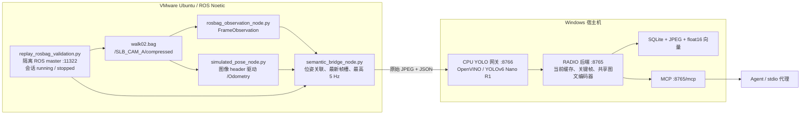

# Agent 交接：walk02 / VMware / ROS / RADIO / YOLO

更新日期：**2026-10-24**。后端已完整迁入 SLAMIBOT FieldMind，源码、模型、索引、图片和报告统一位于下表的新目录，旧目录与旧包名已移除。本文 `data/` 与 `reports/` 路径均相对新工作区，约定见 [迁移说明](repository_migration.md)。后续回放统一使用 `/home/wdy/bag/walk02.bag`，图像只使用 `/SLB_CAM_A/compressed`。先检查已有服务与索引，再决定是否需要回放。

录制“开始任务、暂停看当前视野、开始导航、结束后检索”的交互 Demo，使用 [walk02 演示录制流程](walk02_demo_recording.md)和 `scripts/demo_vm.py`；下文第 6 节的验证回放会自动连续播放，用于无人值守链路验证。

## 1. 当前配置与已验证结果

框架集成代码已迁至 D360 目录的 `feat/semantic-perception-integration` 分支。本次独立构建／协议检查使用 `/home/wdy/semantic_integration_ws`，没有覆盖下表原 Demo 回放工作区；测试范围与实机限制见框架 `docs/features/semantic_perception_validation.md`。

2026-10-24 已完成连接在虚拟机内的实物 OAK 测试，使用 DepthAI 2.30.0.0，三路 JPEG 和 CAM_A 板端 YOLO 工作，20 张关键帧的 RADIO 索引与 MCP 图片读取通过。测试进程已结束，相机已释放。细节、发现的 Buffer／选帧频率问题和识别质量限制见 D360 框架 `docs/features/oak_vm_hardware_validation_20261024.md`；证据位于本项目 `data/oak_vm_hardware_20261024/`。这不是 NX／SLAM 硬触发实机验收。

| 项目 | 当前约定 |
|---|---|
| Windows 项目 | `E:\slb\slb_code\OAK\slamibot-fieldmind` |
| Windows Python | `E:\slb\slb_code\OAK\.venv-radio\Scripts\python.exe` |
| 设备框架源码 | `E:\slb\slb_code\D360\slamibot_d360_framework`，分支 `feat/semantic-perception-integration` |
| VMware VMX | `E:\vm20\Ubuntu20.vmx` |
| VMware 控制程序 | `C:\Program Files (x86)\VMware\VMware Workstation\vmrun.exe` |
| Ubuntu 用户／环境 | `wdy`；Ubuntu 20.04.6 x86_64、ROS Noetic、系统 Python 3.8 |
| Ubuntu 隔离工作区 | `/home/wdy/radio_replay_ws`，构建输出 `build_ros`／`devel_ros` |
| 回放素材／图像 | `/home/wdy/bag/walk02.bag`／`/SLB_CAM_A/compressed` |
| RADIO 后端 | `http://192.168.1.4:8765` |
| CPU YOLO 网关 | `http://192.168.1.4:8766` |
| MCP | `http://192.168.1.4:8765/mcp`，Streamable HTTP |
| 实际索引目录 | `data/walk_rosbag_20261020/index` |
| 相机／任务 | `SLB_CAM_A`／`walk02_bag_simulated` |
| 已验证会话 | `bag-f1d78b8f87e947519acdd925eb808b2a` |
| 坐标会话 | `sim-e9e463f39975486aa37b008369ae3d4b` |
| 已保存结果 | 本会话 178 张关键帧，RADIO 全部 ready，检测全部 available |

索引路径是当前实际使用的持久化目录，继续沿用。库中还包含预演等其他会话，总量通过 MCP `index_status` 现场读取；查询限定上表会话。新回放会生成新的会话和坐标 ID，以该次 `report.json` 为准。

服务在最近核验时正常；电源、IP、PID 与健康状态现场读取，不凭文档快照控制进程。FieldMind 源码仓库为 `hit-wdy/slamibot-fieldmind`；设备框架接入代码已提交至 `feat/semantic-perception-integration`，对应上游 PR #11，仍需完成 NX 实机验收。

## 2. 双端运行架构



Ubuntu 负责 ROS 回放、模拟位姿与转发；Windows CPU 执行 YOLO，RTX 3050 Laptop GPU 执行 RADIO。图文编码共用后端的一个常驻模型，MCP 代理不加载模型、不打开 OAK。回放不运行真实 SLAM，无需在虚拟机安装 GPU 推理环境或构建完整设备工程。

设备目标链路是 OAK 板端 YOLO、Orin RADIO 和真实 `/Odometry`。当前回放验证不能替代板端、真实同步、标定与设备性能验证。

## 3. VMware 连接与文件传输

通过 VMware Tools／VIX 操作客户机，不依赖 SSH。Windows PowerShell 检查：

```powershell
$vmrunPath = 'C:\Program Files (x86)\VMware\VMware Workstation\vmrun.exe'
$vmxPath = 'E:\vm20\Ubuntu20.vmx'
& $vmrunPath list
# 虚拟机未运行时才执行：
& $vmrunPath start $vmxPath nogui
& $vmrunPath checkToolsState $vmxPath
& $vmrunPath getGuestIPAddress $vmxPath
```

等待 Tools 就绪后再复制文件。客户机 IP 以查询为准；后端绑定地址使用已从 Ubuntu 验证可访问的 `192.168.1.4`。若宿主机地址变化，同时修改后端绑定、网关 upstream、回放 URL 和 MCP URL。

下面的 Python 辅助函数在 Windows 项目目录执行。口令从已有授权环境变量 `SLAMIBOT_VM_PASSWORD` 注入，不写入源码或日志；不要打印带凭据的参数数组。

```python
import os
import subprocess
from pathlib import Path

VMRUN = r"C:\Program Files (x86)\VMware\VMware Workstation\vmrun.exe"
VMX = r"E:\vm20\Ubuntu20.vmx"
auth = [VMRUN, "-gu", "wdy", "-gp", os.environ["SLAMIBOT_VM_PASSWORD"]]

def guest(operation, *arguments):
    try:
        result = subprocess.run(
            auth + [operation, VMX] + list(arguments),
            capture_output=True, timeout=30,
        )
    except subprocess.TimeoutExpired:
        raise RuntimeError("VMware guest operation timed out") from None
    output = (result.stdout + result.stderr).decode("utf-8", errors="replace")
    if result.returncode:
        raise RuntimeError(operation + " failed: " + output)
    return output

def put(local, remote):
    return guest("copyFileFromHostToGuest", str(Path(local).resolve()), remote)

def get(remote, local):
    return guest("copyFileFromGuestToHost", remote, str(Path(local).resolve()))

def run_program(program, *arguments):
    return guest("runProgramInGuest", "-noWait", program, *arguments)
```

`runProgramInGuest` 启动成功不代表内部程序完成。程序输出写客户机日志，再复制回 Windows 检查。使用脚本文件和参数数组；经过 Windows → VIX 传递复杂的嵌套 `bash -c` 命令曾出现无有效输出的情况。

## 4. 同步源码与构建 ROS 包

权威源码在 Windows 设备框架的 `src/semantic_perception`，Ubuntu 是复制件。Windows 修改后需要重新同步、构建；保留用户其他 ROS 工作区。

在 Windows 使用上一节辅助函数打包和复制：

```python
import tarfile

package = Path(r"E:\slb\slb_code\D360\slamibot_d360_framework\src\semantic_perception")
archive = Path("data/walk02_semantic_perception.tar.gz")
archive.parent.mkdir(parents=True, exist_ok=True)
with tarfile.open(archive, "w:gz") as handle:
    for path in package.rglob("*"):
        if path.is_file() and "__pycache__" not in path.parts and path.suffix != ".pyc":
            handle.add(path, arcname="semantic_perception/" + path.relative_to(package).as_posix())
put(archive, "/tmp/walk02_semantic_perception.tar.gz")
put("scripts/replay_rosbag_validation.py", "/tmp/replay_rosbag_validation.py")
```

Ubuntu 执行以下命令，也可保存为 shell 文件后通过 `run_program("/bin/bash", "脚本路径")` 启动，将输出写日志：

```bash
unset PYTHONPATH PYTHONHOME
export PATH=/usr/bin:/bin:/usr/sbin:/sbin
source /opt/ros/noetic/setup.bash
mkdir -p /home/wdy/radio_replay_ws/src
tar -xzf /tmp/walk02_semantic_perception.tar.gz -C /home/wdy/radio_replay_ws/src
chmod +x /home/wdy/radio_replay_ws/src/semantic_perception/scripts/*.py
cd /home/wdy/radio_replay_ws
catkin_make --build build_ros -j2 \
  -DPYTHON_EXECUTABLE=/usr/bin/python3 \
  -DEMPY_SCRIPT=/usr/lib/python3/dist-packages/em.py \
  -DPY_EM=/usr/lib/python3/dist-packages/em.py \
  -DCATKIN_DEVEL_PREFIX=/home/wdy/radio_replay_ws/devel_ros
```

使用系统 Python 3.8，清理 Conda 的 PATH、PYTHONPATH、PYTHONHOME；source 的结果必须是 `devel_ros/setup.bash`。`EMPY_SCRIPT` 和 `PY_EM` 显式指向系统 `em.py`。当前包已在 Noetic x86_64 构建通过，包含与后端一致的纯 NumPy YOLO 解码和过滤模块。

## 5. Windows 服务启动顺序

所有命令从 `E:\slb\slb_code\OAK\slamibot-fieldmind` 执行。先检查，已有服务可复用：

```powershell
Get-NetTCPConnection -State Listen -LocalPort 8765,8766 -ErrorAction SilentlyContinue |
  Select-Object LocalAddress,LocalPort,OwningProcess
Invoke-RestMethod http://192.168.1.4:8765/v1/health
Invoke-RestMethod http://192.168.1.4:8766/metrics
```

### RADIO 后端

仅在服务未运行或确需重启时，在单独终端启动：

```powershell
..\.venv-radio\Scripts\python.exe -m slamibot_fieldmind.backend `
  --root data/walk_rosbag_20261020/index --allow-unmounted `
  --host 192.168.1.4 --port 8765
```

等待 `/v1/health` 中 `model_state=ready`、`model_error=null`。历史图像过期时整体 `status=degraded` 可以是预期状态，结合 live 新鲜度、积压和完整性字段判断。服务绑定 `192.168.1.4`，不要假定 localhost 也能访问。

同一个 root 只能有一个写入后端，由 `.backend.lock` 约束。停止服务前检查端口对应的 PID 和命令行，避免结束无关进程。后台启动 PowerShell 服务时使用 `Start-Process -WindowStyle Hidden`，或 Python `CREATE_NO_WINDOW` 并单独保存日志。

### CPU YOLO 网关

环境已具备；确实缺少依赖时才执行 `pip install -e ".[backend,replay-yolo]"`。保持当前 Torch／CUDA 环境。

```powershell
..\.venv-radio\Scripts\python.exe scripts/replay_yolo_gateway.py `
  --model models/yolov6/yolov6nr1_coco_512x288.xml `
  --postprocess-config configs/detection_postprocess.json `
  --upstream http://192.168.1.4:8765 --host 192.168.1.4 --port 8766
```

当前 CPU 运行时是 OpenVINO 2026.4.1，模型文件校验见 `models/assets.json`。输入为 512×288 BGR、中心 ROI 0.15；三路输出使用 `objectness × class_score`，候选阈值 0.20、原生联合分数门槛 0.25、逐类别 NMS IoU 0.45，随后执行分类阈值与车辆冲突／包含去重。配置见 [detection_postprocess.json](../configs/detection_postprocess.json)，实现及取舍见 [YOLO 优化说明](../reports/yolo_optimization_20261022.md)。

网关对桥接转发的 JPEG 实际运行 YOLO，再将相同 JPEG 和结果交给后端。它只提供回放接收、会话通知、健康代理及 `/metrics`，**不提供 MCP**。推理成功但无目标才返回空检测；推理失败返回错误。后端保留 `detection_status=available`、`source_detection_status=unavailable`、`detection_execution=host_cpu_openvino_replay`、模型指纹、原始候选与过滤审计。

## 6. Ubuntu 回放 walk02

### 素材、RTK 与时间

素材为 2,548,009,583 字节、235.8445 秒；CAM_A 共 2359 张，约 10 Hz。只回放 CAM_A，不播放其他相机、IMU、雷达。在清洁 ROS 环境检查：

```bash
/usr/bin/python3 /opt/ros/noetic/bin/rosbag info --yaml /home/wdy/bag/walk02.bag
```

全部 235 条 `/rtk/raw` GGA 校验有效，但定位质量 0、卫星数 0、经纬度为空，因此使用明确标记的模拟位姿。不能用空 RTK 构造真实坐标。

bag 记录时间约 89.753～325.598 秒，图像 header 是绝对时间 `2026-04-15T00:00:41.400443Z` 至约 `00:04:37.200Z`。`/clock` 控制播放节奏；模拟里程计使用每张图像的 header，接收时间单独保存 UTC。不要用 `/clock` 给这些图像的位姿打戳，也不要把图像日期改成今天。实际曝光时间语义仍待实机验证。

### 直接在 Ubuntu 终端运行

先确保 Ubuntu 能访问 Windows 两个 HTTP 端口、后端模型已 ready。`--out` 必须为新目录，`11322` 必须空闲：

```bash
unset PYTHONPATH PYTHONHOME
export PATH=/usr/bin:/bin:/usr/sbin:/sbin
source /opt/ros/noetic/setup.bash
source /home/wdy/radio_replay_ws/devel_ros/setup.bash
/usr/bin/python3 /tmp/replay_rosbag_validation.py \
  --bag /home/wdy/bag/walk02.bag \
  --image-topic /SLB_CAM_A/compressed \
  --camera-id SLB_CAM_A --task-id walk02_bag_simulated \
  --pose-note 'RTK has no fix, satellites=0, no coordinates; simulated pose' \
  --url http://192.168.1.4:8766 --port 11322 \
  --out /home/wdy/radio_replay_runs/walk02_next_run
```

topic／camera 参数必须显式传入，脚本和 launch 的默认值并非本次配置。

### 从 Windows 通过 VIX 启动

将下面内容在 Windows 保存为 `data/walk02_launcher.py`。它在客户机内组织参数，避免 VIX 嵌套引号；每次运行更换输出目录：

```python
import json
import os
import subprocess
from pathlib import Path

runtime_env = dict(os.environ)
runtime_env["PATH"] = "/usr/bin:/bin:/usr/sbin:/sbin"
runtime_env.pop("PYTHONPATH", None)
runtime_env.pop("PYTHONHOME", None)
args = [
    "--bag", "/home/wdy/bag/walk02.bag",
    "--image-topic", "/SLB_CAM_A/compressed",
    "--camera-id", "SLB_CAM_A", "--task-id", "walk02_bag_simulated",
    "--pose-note", "RTK has no fix; simulated pose",
    "--url", "http://192.168.1.4:8766", "--port", "11322",
    "--out", "/home/wdy/radio_replay_runs/walk02_next_run",
]
command = '''
set -e
source /opt/ros/noetic/setup.bash
source /home/wdy/radio_replay_ws/devel_ros/setup.bash
exec /usr/bin/python3 /tmp/replay_rosbag_validation.py "$@"
'''
with open("/tmp/walk02_runner.log", "w") as log:
    result = subprocess.run(
        ["/bin/bash", "--noprofile", "--norc", "-c", command, "walk02-runner"] + args,
        env=runtime_env, stdout=log, stderr=subprocess.STDOUT,
    )
Path("/tmp/walk02_launch_result.json").write_text(json.dumps({"exit": result.returncode}))
```

用第 3 节辅助函数复制并启动，再分次取回日志／报告：

```python
put("data/walk02_launcher.py", "/tmp/walk02_launcher.py")
run_program("/usr/bin/python3", "/tmp/walk02_launcher.py")
# 启动后检查日志；报告在执行过程中逐步生成。
get("/tmp/walk02_runner.log", "data/walk02_runner_latest.log")
get("/home/wdy/radio_replay_runs/walk02_next_run/report.json", "data/walk02_report_latest.json")
# 结束后再取退出码文件，文件不存在不代表已成功结束。
get("/tmp/walk02_launch_result.json", "data/walk02_launch_latest.json")
```

### 回放内部行为与验收

控制脚本启动隔离 `roscore :11322`，通过 `rosbag_replay.launch` 启动观测包装、模拟位姿和桥接节点，发布 running 会话，再播放指定图像 topic。播放结束后排空转发槽、发布 stopped、等待 RADIO 队列完成，关闭本次 ROS 进程组，Windows 服务继续运行。

模拟轨迹以 40 秒为周期，依次静止、平移、原地旋转、平移；坐标系 `simulated_map`，位姿源 `simulated`，相机／body 使用回放专用合成单位外参。它们只用于验证关键帧策略，不能作为真实导航、目标坐标或标定精度证据。

已完成的一次完整回放：2359 图像／2359 模拟里程计／2359 观测，桥接后 YOLO 实际处理 806 张，保存 178 张关键帧；全部 ready／available，HTTP 错误、推理失败、过载和磁盘不足均为 0。最大位姿关联时间差 99.84 ms，处于配置的 100 ms 内。这些是已验证运行的结果，调度变化后数量不要求逐项相同。

桥接最高 5 Hz，后端以最近一张已持久化接受的关键帧为基准：最小间隔 0.5 秒；位移 ≥0.5 米或三维旋转 ≥15° 可触发；间隔 ≥3 秒还要求位移 ≥0.05 米或旋转 ≥2°，静止和小幅抖动不补帧。相机位姿不可用时可比较机身位姿；两者均不可比较时才保留时间采样。YOLO 当前缓存独立更新，RADIO 只编码接受的关键帧。新编号为 `kf-<32位唯一标识>-<UTC时间戳>`，重试幂等，旧编号保留。详见 [关键帧策略](keyframe_policy.md)。

完整播放约 4 分钟，另加启动与队列排空。检查 `report.json` 中 `state=complete`、`rosbag_exit=0`、会话状态 stopped、无 pending；结合 `roscore.log`、`adapter.log`、`rosbag.log` 排查。历史缓存返回 stale 是正常行为。

## 7. MCP 查询与结果解释

九个工具为 `search_frames`、`find_frames`、`describe_view`、`get_frame`、`compare_frames`、`index_status`、`get_frame_image`、`list_sessions`、`list_places`。

Windows 运行 stdio 代理或九工具检查，均连接同一个后端：

```powershell
..\.venv-radio\Scripts\python.exe -m slamibot_fieldmind.mcp_proxy `
  --url http://192.168.1.4:8765/mcp

..\.venv-radio\Scripts\python.exe scripts/check_backend_mcp.py `
  --url http://192.168.1.4:8765/mcp `
  --session-id bag-f1d78b8f87e947519acdd925eb808b2a --camera-id SLB_CAM_A `
  --out reports/walk02_mcp_recheck.json
```

手工检索示例在 Windows 项目环境运行：

```python
import asyncio
import json
import sys
from mcp import ClientSession
from mcp.client.stdio import StdioServerParameters, stdio_client

async def main():
    params = StdioServerParameters(
        command=sys.executable,
        args=["-m", "slamibot_fieldmind.mcp_proxy", "--url", "http://192.168.1.4:8765/mcp"],
    )
    async with stdio_client(params) as (read, write):
        async with ClientSession(read, write) as session:
            await session.initialize()
            response = await session.call_tool("search_frames", {
                "query": "two potted plants", "target_label": "potted plant",
                "top_k": 12, "group_results": False,
                "session_id": "bag-f1d78b8f87e947519acdd925eb808b2a",
                "start_time": "2026-04-15T00:00:40+00:00",
                "end_time": "2026-04-15T00:04:40+00:00",
            })
            if response.is_error:
                raise RuntimeError(str(response.content))
            print(json.dumps(json.loads(response.content[0].text), ensure_ascii=False, indent=2))

asyncio.run(main())
```

默认近 24 小时不会命中素材的历史 header 时间，必须传入覆盖窗口；新回放也保留原始 header。先用 `list_sessions` 确定会话，再限制任务／相机，避免混查。

当前 `search_frames` 是 RADIO 排序后附同帧 YOLO 类别证据，**不自动核验数量或按数量重排**。`supported_by_yolo` 只表示目标类别有检测，不代表整句语义、数量、关系均成立。余弦相似度不是概率，未检测也不是不存在。

“两个盆栽”的真实调用中，原始第一名相似度 0.3236，只检测到 1 个盆栽；第 6 名相似度 0.2502，检测到 2 个盆栽。最终展示第 6 名是 Agent 检查检测数量、取图查看后的选择，不是 MCP 自动选优。`label_counts` 是单帧过滤后的检测框数，仍可能漏检／误检，不是物理对象总数。

`get_frame_image(frame_id, overlay=true)` 返回 MCP 图片内容，解码 base64 后保存。当前按类别固定配色、大字号加底色；`overlay=false` 获取未画框原图。走廊位置等自然语言是 Agent 看图说明；模拟拍摄位姿不能当作目标真实三维位置。当前视野读持续缓存，必须报告观测时间和 stale。

## 8. 持久化、YOLO 当前状态与证据

```text
data/walk_rosbag_20261020/index/
  records.sqlite
  images/...
  vectors/radio_clip_v1/ros-3b9e6eaef982dac31433910e/20260415T00.f16
```

本会话向量文件 364,544 字节，即 178 × 1024 维 × 2 字节，存储归一化 RADIO／CLIP 图像 embedding。SQLite 保存关键帧、图片、检测、位姿、会话及向量分区／行号。备份时同时保留数据库、images 和 vectors。历史查询使用已保存向量，不需要重新编码图片。

当前 YOLO 已采用联合置信度、分类阈值、车辆跨类别冲突及包含框去重；保留人／自行车、盆栽／花盆等合理重叠。后端与 ROS 使用相同的 `yolo_postprocess.py`，不再依赖第三方解析器计算分数。CPU 网关可对部分残留易误检类别增加翻转一致性核验；OAK 板端没有增加该次推理。

记录中的 `detections` 是当前过滤结果；`detections_original`、`detections_raw`、过滤审计与参数用于追溯，不能重新合并计数。此次优化没有更换模型权重、改写原始 JPEG 或 RADIO 向量。阈值存在精度／召回取舍，尚无标注集 mAP；OAK 板端更新尚待实机测试。最近代码验证为非 slow 测试 227 passed、25 deselected，Noetic 包构建与共享解码核对通过；这不是本次文档更新重新运行的测试。

继续调参时，按 [YOLO 优化报告](../reports/yolo_optimization_20261022.md)先只读比较，再停后端应用；修改配置不会自动重算历史检测。

当前证据入口：

- [walk02 素材与全量 RTK 检查](../data/walk02_rosbag_20261021/bag_inventory.json)
- [walk02 ROS 原始运行报告](../data/walk02_rosbag_20261021/guest_report.json)
- [walk02 回放链路统计](../data/walk02_rosbag_20261021/validation_summary.json)：检测类别统计属于该次采集版本，当前检测以数据库和新 MCP 查询为准。
- [当前 MCP 九工具核验](../reports/yolo_optimization_20261021/mcp_after.json)
- [当前完整性与向量校验](../data/yolo_precision_20261021_final/integrity_after.json)
- [Noetic 共享解码构建报告](../data/yolo_precision_20261021_final/ros_build_report.json)
- [两个盆栽的单次搜索返回内容](../reports/two_potted_plants_mcp_search_raw_20261022.json)：保留完整 matches 原始排名，JSON 经格式化保存。
- [两个盆栽的多工具汇总报告](../reports/two_potted_plants_mcp_20261022.json)：sessions／places／search 为各工具响应，images 为 Agent 保存图片的本地路径。
- [两个盆栽的第 6 名图片](../reports/two_plants_kf-93b922c324faa6b2d04cf1e95ba96a35.jpg)
- [设备接入设计与实现](slamibot_integration.md)

## 9. 接手代码入口与后续工作

| 项目／文件 | 用途 |
|---|---|
| RADIO `src/slamibot_fieldmind/backend.py` | HTTP、MCP 九工具入口 |
| `backend_runtime.py`／`semantic_store.py` | 模型调度、缓存、会话、存储 |
| `backend_query.py`／`keyframes.py`／`protocol.py` | 查询、时空选帧、协议校验 |
| `detect.py`／`yolo_postprocess.py`／`annotation.py` | YOLO 解码过滤与分类彩色标注 |
| `scripts/replay_rosbag_validation.py` | Ubuntu 回放控制器 |
| `scripts/replay_yolo_gateway.py` | Windows CPU YOLO 网关 |
| `scripts/check_backend_mcp.py` | 真实 MCP 九工具检查 |
| `scripts/refine_detections.py` | 历史检测只读比较／事务更新 |
| 框架 `src/semantic_perception/scripts/` | 桥接、观测包装、模拟位姿 |
| 框架 `src/semantic_perception/src/semantic_bridge/` | 位姿插值、外参、序号配对、共享 YOLO 后处理 |
| 框架 `src/semantic_perception/launch/rosbag_replay.launch` | 回放模拟源与合成外参 |
| 框架 `src/oak-camera_driver/scripts/oak_hardware_trigger_ros.py` | 设备板端 YOLO 集成 |

建议接手顺序：复用现有索引核对 MCP；确需回放时同步源码，用本指南的显式参数和新输出目录；随后补充数量条件的服务端核验／排序与标注集评估；最后验证 CAM_A 板端 YOLO、真实 SLAM、时钟、外参及 Orin 30 分钟负载。设备框架的任务控制、驱动和 Compose 集成尚不能仅凭离线回放视为完成实机验收。
