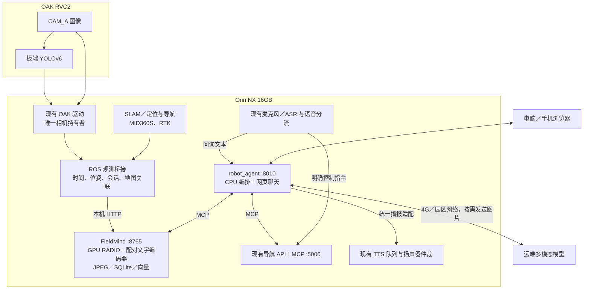

# Orin NX 16GB 设备部署适配评估

评估日期：2026-10-25。此文基于本地源码与官方文档审查，尚未连接目标 Orin 主板，不能视为该设备的性能验收报告。未修改运行代码、设备配置或现有部署。

## 结论与部署边界

单路 OAK 板端 YOLO、Orin 上的 RADIO 关键帧索引、CPU 上的 robot_agent 编排，以及现有 SLAM／导航共机运行，是合理的首版方向。实际可用性取决于现有系统资源占用、JetPack／L4T 与模型冷启动峰值；16GB 与 157 TOPS 不能单独证明所有服务并发满足要求。

robot_agent 部署到设备，并不要求把其调用的大语言／多模态模型也部署到设备。首版建议通过 4G 或园区网络调用远端多模态模型，设备本地保存关键帧、向量与检测结果。断网时采集、YOLO、RADIO 索引和已有自主导航应继续工作；依赖远端模型的自然语言理解与看图核验明确不可用。

## 本次审查范围

| 代码库 | 路径／版本 | 与部署有关的状态 |
|---|---|---|
| SLAMIBOT 框架 | `E:\slb\slb_code\D360\slamibot_d360_framework`，`c0241be` | 已开发 OAK YOLO、semantic_perception、任务会话和 Compose 扩展；需确认实机镜像包含这些改动 |
| 导航框架 | `E:\slb\slb_code\0801\d360_nav2D`，`master`／`698be43` | ROS1 Noetic，FastAPI＋导航 MCP、已有语音助手与 TTS 队列 |
| FieldMind | `e5a87f2` | 已有 Jetson 配置与 Dockerfile；README 的既有未提交修改未触碰 |
| robot_agent | 发布版 `main`：`cac65f3` | 已有双 MCP 接入、多模态核验、网页；本地运行分支含未发布的模型接入代码，设备应使用发布版 |

## 建议的设备数据流



设备内部继续采用 ROS 传感器通道＋本机 HTTP／MCP。这里的 HTTP 不经过 4G；同主机容器采用现有 host 网络时可使用 loopback。YOLO 不经过回放用的 Windows CPU 网关 `:8766`，FieldMind 和 Agent 不再打开 OAK。

## 必须处理的适配

### 1. 获取设备软件基线并冻结 ARM64 依赖

首先运行现有 `scripts/platform_probe.py`，记录 Ubuntu、L4T、JetPack、Python、内存、挂载与 NVIDIA 容器 runtime。探测脚本兼容设备系统 Python；推理环境建立后再加 `--torch` 做 CUDA 运算检查。补查 `nvpmodel -q`、`tegrastats`、存储实际类型和现有容器占用，不能仅凭“157 TOPS”推断当前处于对应功耗配置。

当前 FieldMind `pyproject.toml` 要求 Python ≥3.10、torch ≥2.8.0a0 且 <2.10、配对 torchvision，以及 MCP 2.x。`deploy/Dockerfile.jetson` 也硬性检查 aarch64、CUDA 和 torch ≥2.8；它是待选择基础镜像的模板，不是已验收的目标设备镜像。

NVIDIA 官方矩阵给出了 JetPack 6.2 对应的 PyTorch 2.8 版本，但不能据此随便选同版本号的 x86 或通用容器。应以实际 L4T、ARM64/iGPU 镜像标签、镜像内 CUDA 与 torchvision 为一组验证、固定 digest，并防止 pip 把厂商 CUDA torch 替换成其他构建。

若设备仍为 JetPack 5.x，当前声明的依赖不能原样满足。应单独评估兼容推理环境或降低软件依赖的可行性及回归成本，不自动升级已经承载传感器和导航的宿主机。

robot_agent 使用独立 Python ≥3.11 环境，当前代码实际使用 `asyncio.timeout`，不能塞进 Noetic Python 3.8，也不能直接套用 Ubuntu 22.04 默认 Python 3.10。Agent 不依赖本地 torch／CUDA；使用轻量 ARM64 Python 镜像即可。两个项目分别维护 Linux ARM64 约束，不能复用 Windows lock。

### 2. 优化 FieldMind 冷启动峰值

最需要关注的不是 YOLO，而是 RADIO 的配对 CLIP 文字塔加载过程：

- `models/assets.json` 中 RADIO 权重约 649 MB，DFN5B CLIP 权重约 3.95 GB。
- `third_party/RADIO/radio/open_clip_adaptor.py` 先调用 `open_clip.create_model_from_pretrained` 创建完整模型，再将 `oc_model.visual` 删除；运行时只需文字塔，但启动会经历完整 CLIP 及其权重加载。
- CPU／GPU 在 Orin 上共享物理内存，不能按桌面机的“16GB 系统内存另加显存”计算。把文字编码器移到 CPU 也不等于减少整机内存，还可能增加 CPU 竞争。

建议离线制作同一配对模型的文字塔专用资源，在设备上只构造文字塔、按需映射或分块载入权重；避免完整视觉塔和多份 state dict 同时驻留。该调整必须保持分词器、投影、归一化、权重来源与向量空间一致，并对照原实现验证图文相似度和候选排序。原始 3.95GB 文件不能通过简单删文件替代加载逻辑修改。

保留 RADIO 图像和文字请求的单实例串行调度。先以当前 `[512]` 保持全视野、batch=1 和 BF16 建立基准；FP16、降低分辨率、TensorRT 等在实测有需要后再做。修改精度／预处理／模型时遵循已有指纹约束，使用新 collection 或重建相关向量，不能混用旧索引。

157 TOPS 是指定条件下的 INT8 指标；当前 BF16 PyTorch 路径不会自动使用 DLA，也不能据该数值推算 RADIO 帧率。参考 NVIDIA 的 Orin Super 模式说明，最终确认功耗、供电和散热条件。

### 3. 合并巡检生命周期与坐标归属

现有桥接默认订阅 `/Odometry`，其会话来自设备框架的 `/perception/session`。导航已有独立任务／地图生命周期，但本次未发现它向该感知会话发布通知。只部署服务可能出现“看得到当前画面，但导航巡检没有被正常纳入历史索引”的情况。

需要新增统一感知会话协调：建图任务与导航巡检都能启动／停止历史记录，但保留独立 `task_id`、本次运行 `session_id` 和 `coordinate_id`；与 SLAM 重启、地图切换、时间回退和定位失效联动，避免多个控制器同时覆盖同一 latched 会话。

坐标方面存在明确差异：

- FieldMind 记录桥接同步的 `/Odometry` 及 body／camera pose。
- 导航目标在 `nav_multi_node.py` 中使用 `map` frame。
- 导航 API 的位姿主要来自 `/amcl_pose`；3D 定位代码另有 `/localization`。实际启用的定位链路需按设备 launch 核实。
- 导航 `ros_client._on_pose` 当前缓存位置和四元数，但未在返回值保留原始 stamp、协方差与新鲜度，不宜用 HTTP 最新位姿直接配历史图像。

首版建议继续用连续局部里程计做时空关键帧判断，另外按采集时间记录 `map_id`、地图版本、定位有效性、map 位姿或 `T_map_odom`。AMCL 跳变／重定位不应被误当作真实行进距离。地点同步导航点位的真实 ID、名称、半径与地图归属；只在同一有效地图或已知坐标变换内回答“距东门多远”。

“在某处拍到目标”的相机位置仍不等于目标的三维位置，更不等于可直接下发的安全导航目标。RTK 保留 fix 状态、精度与时间差，暂不覆盖局部 SLAM 坐标。

### 4. 接通语音，并适配导航 MCP 的返回语义

导航已有 `/api/assistant/turn`、`/api/assistant/speak`、异步作业状态、统一 TTS 队列、PTT／talkback／播放互斥。这些应复用，不能让 robot_agent 新开一份麦克风或直接调用 aplay 抢扬声器。

当前 `assistant.py` 对部分语音来源默认关闭普通 CHAT；开放后 CHAT 也调用原讯飞网关，不会自动转交 robot_agent。应增加明确的对话后端分流，把“当前有什么／找目标”等问询交给 robot_agent；已有明确控制指令沿用导航确定性通道，并确保同一句话只由一个通道执行。新入口保留 requestId、来源、唤醒及作业状态，不要把模型回复重新输入动作解析。

本次源码中的导航 MCP 未注册 `speak`／`speaker_status`，尽管 Agent 提示词在工具存在时支持它们。可增加两个薄工具适配现有 TTS／状态接口，或者让语音入口负责最终播报，必须选择一种播报责任，防止两处重复播报。异步“已排队”与“已播放”分别报告。

另一个实际差异：导航使用 `{"success":false,"msg":...,"data":...}`；Agent 当前 `_tool_ok` 主要识别 ToolMessage error 及文本中的 `"ok":false` 等。需要从完整结构化输出读取 success／错误，不依赖截断的文字摘要。任务接受、开始执行和完成也需要分开，使用状态工具确认结果。

### 5. 做设备部署入口与故障恢复

| 项目 | 已有基础 | 需要补充 |
|---|---|---|
| FieldMind 镜像 | `deploy/Dockerfile.jetson` | 验证基础镜像、Linux ARM64 锁定、离线资源和低峰值加载 |
| 设备编排 | `docker-compose.semantic.yml` | Agent 服务、启动依赖、日志轮转、资源观测、配置样例与版本冻结 |
| Agent | 通用 `.env`、`python api.py` | Python ≥3.11 ARM64 Dockerfile／systemd；不要复制 Windows Kimi 本机接入方式 |
| 网页 | Agent 自带静态页面 | 设备 LAN 访问；如接现有导航 Nginx，处理路径前缀和 SSE 代理配置 |
| 数据 | JPEG＋SQLite WAL＋float16 分区 | 明确持久化磁盘、开机挂载、断电重启与备份；保留低盘暂停策略 |
| 服务降级 | FieldMind 已有状态／队列上限 | Agent 启动容忍暂时离线 MCP、重连与能力刷新，不因某个服务重启整机 |

现有 FieldMind 写入强制要求 `/mnt/usb` 是挂载点，即使 `--root` 指向其他地方也会先检查该目录。如果实机用 NVMe 而不是 `/mnt/usb`，应改为校验实际数据卷，或提供一致的挂载布局，不能生产部署时长期使用 `--allow-unmounted`。

现有 JPEG 保存、KF 编号、时空选择、SQLite／向量协议可以保留。地图信息以协议／存储迁移方式补充，不必因为换主机重写整个存储层。`third_party/RADIO` 和模型没有完整随 Git 分发，镜像构建前必须按固定源码 commit 准备第三方目录及校验后的离线模型缓存。

内部接口示例（host 网络且沿用当前导航端口时）：

```dotenv
MCP_LOCAL_ENABLED=false
FIELDMIND_MCP_URL=http://127.0.0.1:8765/mcp
NAV_MCP_URL=http://127.0.0.1:5000/mcp
AGENT_SYSTEM_PROMPT_FILE=prompts/slamibot_fieldmind.md
AGENT_BUILTIN_TOOLS=off
API_PORT=8010
```

`LLM_BASE_URL`、`LLM_MODEL`、`LLM_API_KEY` 按实际远端多模态服务配置。使用同一镜像内网桥网络时改用对应服务名；127.0.0.1 不跨普通 Docker 网络。传感器驱动继续保持唯一硬件所有者与现有 ROS Master，不为 Agent 或 FieldMind 再启动一个 roscore。

## 资源与长期运行优化

- 先测“原框架＋导航”空闲、定位、行驶、地图加载时的资源基线，再添加 FieldMind。记录冷启动最高占用、稳定 RSS／CUDA 分配及整机 MemAvailable；不能只看 torch 的 GPU allocation。期望保留 2～3GiB 整机余量，这是工程目标，不是已经测得的占用保证。
- 优先保障传感器、SLAM、底盘与导航；限制新进程的 PyTorch／BLAS CPU 线程、并发查询和图像预处理并发。具体配额通过实测决定，不预先把 8 核硬性分满。
- 保留图像队列 4 项、持久化 pending 32 项和静止不补帧策略；负载超限时让语义索引降采样／暂停接收，当前 YOLO 缓存继续更新。
- 当前历史搜索仍会收集匹配范围内的全部记录，再读成 float32 向量矩阵。应增加分块 top-k、分页／时间过滤下推与查询并发上限。以 D=1024 为例，10 万帧仅矩阵就约 391MiB，尚不含检测 JSON 和多份记录对象。
- 首版不在 NX 上再同时常驻大语言／多模态模型。若必须离线对话，另设小模型专项，连同 ASR、RADIO、导航一起测试，不能把“Agent 能运行”当作“所有模型能共机运行”。
- 4G 下按需先取 1 张、再补候选，提供 768～1024 长边等可配置的上行预览预算；后端原始存图不因此缩小。保留图片与帧元数据绑定，不在弱网失败时声称完成看图核验。
- 明确网络断开、定位失效、模型失败、磁盘不足和相机离线的不同状态。停止生成回答只停止对话，不替代现有导航取消或底盘急停。

## 实施与验收顺序

1. **基线探测**：确认实机软件／镜像版本、时钟源、正在运行的 SLAM／定位实例和现有资源峰值；不升级宿主机。
2. **依赖与模型**：构建 ARM64 环境，验证冷启动、单次图文编码、同图检索排序及重启恢复；先解决内存峰值。
3. **单路实采**：接 CAM_A 板端 YOLO 和真实位姿，确认图像／检测序号、外参、会话、地图归属；不用回放 CPU 网关。
4. **Agent 与语音**：接入两个 MCP，验证结构化失败、问询分流、TTS 单次播放、弱网降级和网页图片。
5. **并机负载**：先 30 分钟验收，再延长 2～4 小时；覆盖导航、静止、转弯、地图切换、网断、服务重启和低磁盘。记录 SLAM 频率、关键帧索引延迟、当前缓存年龄、CPU／内存／温度／功耗与漏采。

沿用此前 P95 当前检测缓存年龄 ≤1s、关键帧 ready ≤3s、SLAM 频率下降 ≤10% 的目标，全部标记为待实测。比较时使用相同路线、地图与功耗模式，历史记录和“模型已就绪”不能代替实时新鲜度。

## 模型发布许可需单独解决

本仓库 `models/assets.json` 已记录研究用途限制，官方现有条款也明确：RADIO 限研究／评估非商业使用；Apple DFN5B 条款将商业产品开发与商业产品／服务排除在 Research Purposes 之外。设备销售方案不能默认把当前权重作为可商用发行资源，应确认所用版本的授权，或选择可满足用途的替代配对模型并重建向量。此项与能否在 ARM64 上运行是不同问题。

## 官方资料

- [NVIDIA JetPack 6.2：Ubuntu、L4T、CUDA 与 Super 模式](https://developer.nvidia.com/embedded/jetpack-sdk-62)
- [NVIDIA Jetson PyTorch 兼容矩阵](https://docs.nvidia.com/deeplearning/frameworks/install-pytorch-jetson-platform-release-notes/pytorch-jetson-rel.html)
- [NVIDIA JetPack 6.2 Super 模式与 Orin NX 性能说明](https://developer.nvidia.com/blog/?p=95089)
- [Luxonis RVC2 硬件与板端推理](https://docs.luxonis.com/hardware/platform/rvc/rvc2)
- [RADIO 官方模型许可](https://huggingface.co/nvidia/RADIO/blob/main/LICENSE)
- [DFN5B 官方模型许可](https://huggingface.co/apple/DFN5B-CLIP-ViT-H-14-378/blob/main/LICENSE)
