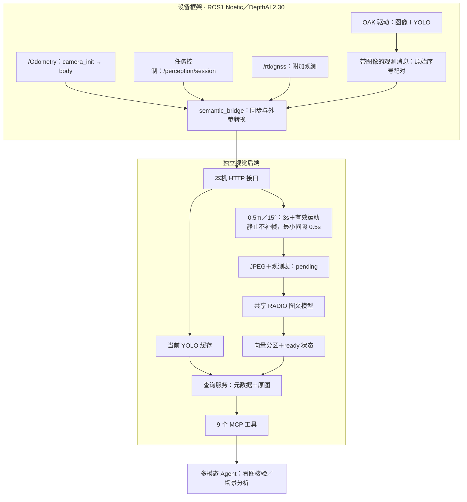

# SLAMIBOT FieldMind 视觉记忆后端接入说明

本仓库为 FieldMind 独立后端，模块命令统一使用 `slamibot_fieldmind`，不提供旧包名兼容入口。源码、模型和历史数据已完整迁入新目录，详见 [迁移说明](repository_migration.md)。

此后端面向 Orin NX＋MID360＋OAK 的 ROS1 Noetic 设备。首版接入 CAM_A，
OAK 由设备驱动独占，YOLO 在 OAK VPU 上推理，RADIO 在 Orin 上异步处理关键帧。
代码与离线验证已提供；ARM64 编译、真实图像时间同步和 30 分钟设备性能验收仍需实机完成。

## 架构与职责



ROS 节点不导入 PyTorch、RADIO 或 MCP，网络发送不占用图像回调。后端不导入 DepthAI，
也不会打开相机。SQLite 由单写入线程维护，目录使用进程锁防止重复启动后端。
普通查询使用短连接；图文推理使用同一模型实例和调度线程。

原 `/keyframe` 是三路横向拼图预览，时间戳为拼图时刻，不用于本后端的关键帧索引。
原来的 rosbag 录制和预览仍可使用。首版不增加连续视频保存。

## 先在本机启动

从本项目目录运行：

```powershell
..\.venv-radio\Scripts\python.exe -m pip install -e ".[backend,dev]"
..\.venv-radio\Scripts\python.exe -m slamibot_fieldmind.backend --root data/backend --allow-unmounted
```

默认监听 `127.0.0.1:8765`，MCP 地址为 `http://127.0.0.1:8765/mcp`。
`--allow-unmounted` 是开发环境的显式覆盖；设备默认要求数据根位于挂载卷内。
默认挂载卷是 `/mnt/usb`，用 `--mount-path` 改成实际卷（如容器内 `/data`）。
未找到模型时服务保持可用并报告 `model_state=failed`，当前缓存和观测仍可接收，
历史 pending 最多 32 条；修复模型后重启可恢复这些待处理记录。

本地 stdio 客户端连接同一后端：

```json
{
  "mcpServers": {
    "slamibot-fieldmind": {
      "command": "E:/slb/slb_code/OAK/.venv-radio/Scripts/python.exe",
      "args": ["-m", "slamibot_fieldmind.mcp_proxy", "--url", "http://127.0.0.1:8765/mcp"]
    }
  }
}
```

代理只转发 MCP，不加载第二个模型。旧 `slamibot_fieldmind.mcp_server` 保留原有单机模式，
其当前视野入口仍会打开相机；设备集成应使用新后端与代理。
默认只开放回环地址，跨机器接入可用 SSH 端口转发。

## ROS 框架编译与启用

设备框架当前开发目录为 `E:\slb\slb_code\D360\slamibot_d360_framework`，分支为
`feat/semantic-perception-integration`。新增 `semantic_perception` 包，包含消息、桥接节点、位姿工具和 DepthAI 2.30 检测分支。
任务生命周期、观测协议和实际验证范围见框架的 `docs/features/semantic_perception.md`。
在 ARM64 ROS 环境中构建：

```bash
source /opt/ros/noetic/setup.bash
catkin config --install
catkin build semantic_perception ros1_oak_ffc_sync project_control
source install/setup.bash
```

先从本项目的固定模型归档提取 blob 和配置，复制到设备的 `/etc/slamibot/models/yolov6`：

```bash
python3 scripts/prepare_oak_model.py --out /etc/slamibot/models/yolov6
```

此脚本校验归档摘要，只提取已知模型文件，不下载、不转换、不更换权重。
在设备框架工作区启动传感器与桥接：

```bash
roslaunch project_control sensors.launch semantic_enabled:=true semantic_backend_url:=http://127.0.0.1:8765
```

相机分支默认参数：`semantic_yolo_hz=10`、`semantic_roi_inset=0.15`、
`semantic_confidence=0.25`（objectness × class score，之后应用逐类阈值和去重策略），模型路径参数为 `semantic_blob`。
不启用时现有驱动按原方式工作。三路相机仍输出原话题，只有 CAM_A 增加 YOLO。
模型文件或配置缺失时降级为图像观测，明确标记 `detection_status=unavailable`；基础相机流和 RADIO 关键帧仍可继续工作。
`/perception/task_status`、`/perception/cam_a/status`、`/perception/status` 分别报告任务、检测和桥接状态。
硬件触发频率由现有设备链路控制；YOLO 分支限频不能提高真实输入频率。

新增消息 `/perception/cam_a/observation` 将 JPEG、原始设备序号、设备时间、
UTC 接收时间、时间来源、检测状态和检测结果打包。驱动按设备序号配对，
检测超时返回 `unavailable`；推理成功但没有目标返回 `available` 和空列表。

桥接配置见设备框架 `src/semantic_perception/config/bridge.yaml`，默认订阅：

| 数据 | 话题 | 处理 |
|---|---|---|
| CAM_A 观测 | `/perception/cam_a/observation` | 最新帧单槽缓存，最高 5 Hz 转发 |
| SLAM | `/Odometry` | 最近 5 秒缓存，100 ms 关联上限 |
| 任务会话 | `/perception/session` | 启停、任务 ID、SLAM 与坐标会话 |
| RTK | `/rtk/gnss` | 保留定位状态与时间差，不代替 SLAM 位姿 |

平移线性插值，旋转使用 SLERP。没有包围样本时只允许取 100 ms 内的最近样本，
不做运动外推，并记录实际时间差。没有有效样本时位姿为 null，按时间策略保留关键帧。

### 外参和时间可信度

优先配置桥接的 `T_body_camera`，它把相机坐标转换到 body。未配置时，
使用当前框架全局参数 `extrinsic_lidar2imu_R/T` 和 `cam0/T_lidar_cam` 推导：

```text
T_world_camera = T_world_body × T_body_lidar × inverse(T_camera_lidar)
```

矩阵必须通过刚体变换检查并记录摘要。缺少外参或 body 坐标系不匹配时，
只保留 body 位姿，相机位姿为 null，不采用单位矩阵兜底。

现有相机图像时间来自最新雷达共享时间，标记为近似同步；退回主机时间时标记为
`receive_time_only`。时间接近不代表已经验证曝光同步。首次部署必须检查设备序号关联、
共享时间更新、相机曝光相位和 SLAM 时间差，完成验证前不宣称精确目标定位。

任务名称不代表全局地图。每次实际启动 SLAM 生成新的 `session_id`；时间回退或坐标系变化
生成新的 `coordinate_id`。相同 `camera_init` 名称不能用来判定两次建图处于同一坐标空间。

## HTTP 与 MCP 接口

所有接口以 `/v1` 为前缀：

| 方法与路径 | 用途 |
|---|---|
| `POST /v1/sessions` | 接收任务状态通知 |
| `GET /v1/sessions` | 列出任务与覆盖 |
| `POST /v1/observations` | multipart：`metadata` JSON 文本＋`image` JPEG 二进制 |
| `GET /v1/health` | 模型、积压、输入新鲜度、磁盘、延迟、向量完整性 |
| `PUT /v1/places` | 登记或更新地点 |
| `GET /v1/places` | 列出地点 |
| `GET /v1/frames/{frame_id}` | 查询关键帧，包含 pending／failed |
| `GET /v1/frames/{frame_id}/image` | 图片；支持 `overlay=true&max_edge=1280` |

观测主要字段：

```json
{
  "protocol_version": 1,
  "session_id": "slam-example",
  "coordinate_id": "slam-example",
  "camera_id": "CAM_A",
  "device_id": "oak-device-id",
  "source_id": "oak-driver-boot-id",
  "source_sequence": 123,
  "source_stamp_ns": 1700000000000000000,
  "device_timestamp_ns": 123000000000,
  "received_at": "2026-10-16T00:00:00+00:00",
  "timestamp_source": "latest_lidar_shared_approximate",
  "sync_quality": "approximate",
  "body_pose": null,
  "camera_pose": null,
  "detection_status": "available",
  "detections": []
}
```

位姿存在时提供 `x/y/z/qx/qy/qz/qw/frame/source`，四元数按 xyzw；真实桥接的 source 为
`slam`。`captured_at` 仅在原始时钟可解释为 UTC 时提供，否则使用接收时间展示，
原始纳秒时间保留。帧 ID 为 `kf-<32位哈希>-<YYYYMMDDTHHMMSSmmmZ>`，例如
`kf-93b922c324faa6b2d04cf1e95ba96a35-20261025T010807123Z`。
哈希来自会话、坐标会话、设备、相机、驱动启动 ID 和原始序号；时间取采集 UTC，
缺失时取接收 UTC。独立的 `observation_key` 唯一索引负责去重，即使重试接收时间变化，
也返回首次保存的编号、图片和记录。观测表版本 1 自动迁移到 2，旧编号和图片不改名。

选帧以最近一张**已持久化接受**的关键帧为基准，首帧立即接受。随后满足最小间隔
0.5 秒，平移 ≥0.5 米或旋转 ≥15° 触发；3 秒超时补帧还要求平移 ≥0.05 米或旋转 ≥2°，
静止及阈值内抖动不补帧。相机位姿不可比较时可使用同一坐标系的两帧机身位姿判断运动，
相机位姿仍保持缺失；没有可比较位姿时按时间采样，不能宣称已过滤静止场景。
参数、状态和边界见 [关键帧策略](keyframe_policy.md)。

MCP 共 9 个工具：原有 `search_frames`、`find_frames`、`describe_view`、`get_frame`、
`compare_frames`、`index_status`，以及 `get_frame_image`、`list_sessions`、`list_places`。
语义检索继续保持 RADIO 排序，然后增加同帧 YOLO 类别证据；不支持的类别返回 RADIO 候选。
`search_frames`、`describe_view` 默认以 MCP `CallToolResult` 返回首条 JSON、逐图上下文文字与原图 `ImageContent`，并提供相同的 `structuredContent`。最多自动附 3 张图、最长边 1280 像素；可通过 `include_images=false` 关闭。当前图片与元数据在同一锁内取快照，无须成为历史关键帧，检测失败时也可返回图片。后端不增加 VLM，`visual_review.performed=false` 明确表示应由调用侧多模态 Agent 完成核验；最高相似度不是存在性证明。详见 [多模态证据与核验](multimodal_review.md)。
文字检索推荐英文，余弦不是存在概率。支持任务、会话、地点、参考帧及显式坐标半径过滤。

登记地点示例：

```bash
curl -X PUT http://127.0.0.1:8765/v1/places -H 'Content-Type: application/json' \
  -d '{"place_id":"east_gate","name":"小区东门","coordinate_id":"slam-example","frame":"camera_init","x":10,"y":2,"z":0,"radius_m":3}'
```

地点名称可能重复；Agent 应先 `list_places` 获取 ID，再调用
`describe_view(mode="location", place_id="east_gate")`。地点默认绑定坐标会话，
未接入稳定地图变换前不跨会话搜索。地点查询返回该区域最新的历史观测，始终附带时间与过期标记。
返回的位置是“相机在哪里拍到”，不是目标三维位置。

## 持久化、恢复和容量

默认根目录为 `/mnt/usb/slamibot_record_data/semantic_index`：

```text
records.sqlite               旧记录表＋版本化 observations／sessions／places 表
images/kf-xx/kf-....jpg       关键帧 JPEG
vectors/<collection>/<stream>/<hour>.f16
vectors/<collection>/<stream>/<hour>.json
.backend.lock                进程锁
```

向量存储流按设备、相机、会话和采集进程隔离，避免序号重置或重复回放触发旧表唯一键冲突。
对外仍返回实际 `camera_id`，存储流 ID 可从 `get_frame.vector.stream_id` 查询。

图片原子落盘后登记 pending；向量与旧 frames 行提交成功后再更新 ready。
语义检索只加载 ready，检测查询和证据读取可以返回 pending／failed。
pending 重启恢复，failed 保留异常原因。旧版本 2 的记录通过附加观测表迁移，原始向量不改写；
旧图片、定位与检测有效性信息缺失时明确标记未知。不支持的旧模式拒绝写入。

内存只预取最多 4 条任务，持久化 pending 上限 32 条。达到上限或磁盘可用空间低于 2 GiB
时暂停历史采集，当前缓存继续更新；状态接口返回过载、漏采和磁盘计数，不静默承诺 3 秒覆盖。
向量追加发现截断时拒绝继续写入，完整但未引用的尾行保留并报告完整性异常，不自动修复或删除数据。

## Orin NX 部署

首先在设备运行只读探测，在选定推理容器中补充 CUDA 检查：

```bash
python3 scripts/platform_probe.py --out platform.json
python3 scripts/platform_probe.py --torch --out platform-inference.json
```

按设备实际 L4T／JetPack 对照 NVIDIA 官方兼容矩阵选择基础镜像：
<https://docs.nvidia.com/deeplearning/frameworks/install-pytorch-jetson-platform-release-notes/pytorch-jetson-rel.html>

当前后端要求 Python ≥3.10、PyTorch 2.8／2.9 和配套 torchvision；支持 NVIDIA 的版本后缀。
先验证镜像与宿主机 CUDA 兼容，再安装后端；不自动升级宿主机、不使用 Windows CUDA wheel。
如果设备版本无法提供这一组合，先保留已完成的代码和回放结果，单独处理推理环境兼容。

实测限制：JetPack 5.x（L4T r35，Ubuntu 20.04／Python 3.8／CUDA 11.4 驱动）没有
torch ≥2.8 的 aarch64 构建，也没有 Python ≥3.10 的 CUDA torch，因此**单进程内**无法同时
满足后端（`mcp>=2.3` 需 Python ≥3.10）与 GPU 推理。

已实测可行的方案是**双解释器侧车**：Python 3.8 进程持有 CUDA 11.4 torch 与模型，
Python 3.11 后端通过 loopback HTTP 取向量（`--encoder-url`）。GPU `float32` 的
fingerprint 与 CPU 完全相同，历史索引可直接复用；实测单帧 P50 1040 ms、关键帧 ready
P50 1.54 s，达到 ≤3 s 目标。步骤见
[Orin NX GPU 编码侧车](orin_nx_gpu_encoder.md)。

回退仍保留：`configs/jetson.yaml` 的 `device: auto` 在无 CUDA torch 时回退 CPU，
并把实际设备写入 `/v1/health` 的 `environment`；CPU 可用但不满足实时索引目标。
完整实测与修正见 [Orin NX 实机部署验证](orin_nx_deployment_validation.md)。

```bash
# BASE_IMAGE 必须是平台探测后选定的 NVIDIA ARM64 GPU 镜像（JetPack 6）。
docker build -f deploy/Dockerfile.jetson --build-arg BASE_IMAGE="$BASE_IMAGE" -t slamibot-fieldmind:jetson .
```

模型和缓存通过只读卷挂载到 `/opt/slamibot-fieldmind/models`；固定 RADIO 源码随镜像打包。
先确保所有资产离线齐备，运行配置为 `configs/jetson.yaml`。实际可运行组合通过
`platform_probe.py --torch` 输出包版本清单锁定，不以开发电脑的速度推断 Orin 性能。

设备框架编译 install 后，构建包含新包和任务控制的本地固件镜像，再启用 Compose 覆盖：

```bash
docker build -t slamibot-firmware:semantic .
export FIELDMIND_MODELS_DIR=/absolute/path/to/slamibot-fieldmind/models
export FIELDMIND_BACKEND_IMAGE=slamibot-fieldmind:jetson
docker compose -f docker-compose.yml -f docker-compose.semantic.yml up -d
```

仓库内 `deploy/docker-compose.semantic.yml` 是可直接运行的后端服务定义（host 网络、
数据卷、`--mount-path /data`、日志轮转与健康检查）。

覆盖文件同时使用新的 core／传感器／OTA 固件，新增独立 GPU 后端服务。
只关闭新增后端和桥接即可回退到原传感器路径；旧记录和图片不删除。
模型来源、摘要和许可说明见 `models/assets.json`。

## 回放与验收

已有 walk60 可以直接用于真实 RADIO 回放，使用新的输出目录：

```powershell
..\.venv-radio\Scripts\python.exe scripts/replay_backend.py --manifest data/captures/walk60/manifest.json --root data/backend_replay --serve
..\.venv-radio\Scripts\python.exe scripts/check_backend_mcp.py --out reports/backend_mcp.json
..\.venv-radio\Scripts\python.exe -m pytest tests/test_semantic_backend.py -q
```

回放复用录制的 YOLO 结果和真实图片，重新运行 RADIO。没有真实 SLAM 的历史素材不会伪造相机位置。
输出 `replay_report.json` 和叠框证据 `evidence.jpg`；回放历史素材的当前视野应报告 stale。

新增测试覆盖时空阈值、俯仰旋转、四元数正负等价、位姿同步、外参转换、检测错序和超时、
任务停止、缺失位姿、跨会话隔离、重复提交、队列过载、磁盘不足、模型异常、重启恢复及 HTTP/MCP。
检测解码与当前项目已验证的解析器对照测试。

实机验收需运行 30 分钟，记录内存、温度、YOLO 输入／输出频率、SLAM 基线与启用后频率、
当前缓存年龄、实际关键帧间隔、推理积压、漏采及索引延迟。
目标：当前检测缓存 P95 年龄 ≤1 秒、关键帧接受到 ready 的 P95 ≤3 秒、SLAM 频率下降 ≤10%。
这些是待实测目标，不是本机回放已经证明的设备性能。

在设备框架中可使用只读采集脚本分别记录基线与启用后的运行：

```bash
rosrun semantic_perception benchmark_semantic.py --baseline-only --duration 60 --out baseline.json
rosrun semantic_perception benchmark_semantic.py --duration 1800 --baseline baseline.json --out enabled.json
```

采集器记录 `/Odometry` 实际频率、后端健康快照、温度和系统内存；运行时需保持 SLAM 任务有效。
